# VMware NSX – Hướng dẫn triển khai POC dành cho Cloud Engineer mới

> **Phạm vi:** NSX networking cơ bản trên môi trường VMware vSphere POC **1 ESXi host**.  
> **Đối tượng:** kỹ sư mới chưa có nền tảng VMware NSX.  
> **Nguồn chính:** file `NSX-T.docx` được cung cấp, gồm 43 ảnh thao tác theo trình tự: đăng nhập → license → compute manager → transport zones → IP pools → uplink profiles → chuẩn bị ESXi → NSX Edge → Edge Cluster → Tier-0 và routing → kiểm tra.  
> **Phiên bản tài liệu:** 1.0 · 20/10/2026. Đường dẫn menu có thể khác tùy phiên bản NSX và license; kiểm tra giao diện thực tế trước khi thao tác.

## 1. Đọc phần này trước khi cài

### 1.1. Mục tiêu học tập

Sau khi hoàn thành lab, kỹ sư mới có thể:

1. Giải thích ESXi, vCenter, NSX Manager, Host Transport Node và Edge Transport Node khác nhau thế nào.
2. Phân biệt **Management network**, **TEP/Overlay underlay** và **Tier-0 external uplink**.
3. Hiểu ý nghĩa của Transport Zone, IP Pool, Uplink Profile, Transport Node Profile, Edge Cluster, Tier-0 Gateway.
4. Tạo cấu hình nền tảng NSX theo đúng thứ tự phụ thuộc, kiểm tra trạng thái và xử lý các lỗi cơ bản.
5. Nhận biết giới hạn của POC chỉ có một ESXi host, không nhầm với kiến trúc HA production.

**Ranh giới tài liệu:** tài liệu gốc **không có quy trình triển khai NSX Manager OVA**, không mô tả hoàn chỉnh subnet/VLAN external uplink, không có bước tạo Tier-1 hoặc tenant VM. Phần kiến thức nền và điều kiện chuẩn bị dưới đây được **bổ sung để phục vụ đào tạo**. Không tự hiểu các ví dụ trong guide là địa chỉ/tên VLAN thực tế của POC.

### 1.2. Bức tranh tổng quan

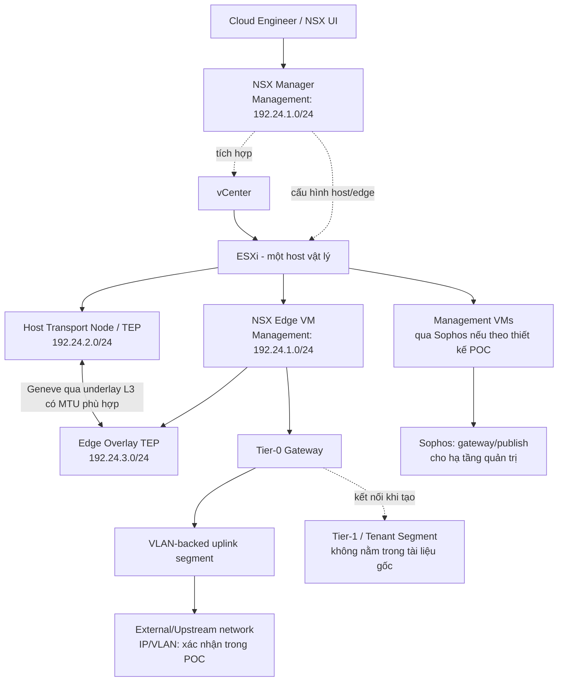

**Cách đọc sơ đồ:** host TEP và Edge TEP phục vụ đường hầm **Geneve**; địa chỉ TEP không phải IP gateway của tenant. Tier-0 đi ra external uplink thông qua VLAN-backed segment. **Không mặc định đặt Sophos ở sau Tier-0**; Sophos trong POC có thể phục vụ các VM quản trị như đã mô tả, độc lập với đường uplink tenant. Hai dải TEP khác subnet phải có **L3 routing hai chiều** trên underlay và MTU phù hợp; nếu không có router/underlay tương ứng, không được cấu hình rập khuôn IP bên dưới.

### 1.3. Thuật ngữ cốt lõi

| Thuật ngữ | Hiểu đơn giản | Vai trò |
|---|---|---|
| **NSX Manager** | Bộ não quản lý | Giao diện quản trị/API; tạo chính sách, logical network và cấu hình tới host/edge. |
| **Compute Manager** | Kết nối vCenter vào NSX | NSX biết danh sách host, cluster, datastore, mạng và triển khai Edge VM. |
| **Transport Zone (TZ)** | Phạm vi các node có thể sử dụng một loại segment | `Overlay TZ` cho Geneve Segment; `VLAN TZ` cho VLAN-backed Segment. |
| **TEP (Tunnel Endpoint)** | IP đầu mút đường hầm Geneve | Dùng bởi Host và Edge để vận chuyển traffic overlay qua underlay IP. |
| **Underlay** | Mạng IP bên dưới | Phải đảm bảo TEP hai đầu liên lạc được và đủ MTU. |
| **Overlay** | Mạng logic bên trên underlay | Kết nối các workload qua Geneve, tách khỏi physical VLAN per tenant. |
| **Uplink Profile** | Chính sách uplink của Transport Node | Teamming, uplink name, Transport VLAN/MTU tùy kiểu cấu hình. |
| **Transport Node Profile (TNP)** | Mẫu cấu hình NSX host | Áp cho ESXi/cluster gồm VDS, TZ, uplink profile, TEP pool, mapping. |
| **Edge Transport Node** | VM thực thi dịch vụ gateway/N-S | Chạy các service router (SR) cho Tier-0/Tier-1 khi cần. |
| **Edge Cluster** | Nhóm các Edge Node | Nơi Tier-0 và network services dùng Edge; không đồng nghĩa tự có physical HA. |
| **Tier-0 (T0)** | Gateway ra external network | Kết nối mạng NSX với upstream; route/NAT/advertisement tùy thiết kế. |
| **Tier-1 (T1)** | Gateway tenant/lớp ứng dụng | Thường nối tenant segment vào T0; chưa có trong tài liệu gốc. |
| **Route Redistribution** | Chọn loại route được đưa sang quá trình quảng bá khác | Có ý nghĩa khi cần route advertisement (ví dụ BGP); không thay cho static routing. |

### 1.4. Kế hoạch IP minh họa thống nhất

Ba subnet dưới đây là **ví dụ nhất quán cho tài liệu học tập**, không khẳng định chúng đã tồn tại trong POC.

| Nhóm | Subnet ví dụ | IP minh họa | Ghi chú |
|---|---|---|---|
| Management | `192.24.1.0/24` | GW `.1`, NSX Manager `.10`, vCenter `.11`, ESXi `.12`, Edge01 `.20`, Edge02 `.21` | Các VM/host management truy cập được DNS/NTP. Địa chỉ chỉ mang tính ví dụ. |
| Host Overlay TEP | `192.24.2.0/24` | Gateway `.1`; pool `192.24.2.100–192.24.2.149` | Dành cho VMkernel TEP trên ESXi. |
| Edge Overlay TEP | `192.24.3.0/24` | Gateway `.1`; pool `192.24.3.100–192.24.3.149` | Dành cho Edge Overlay TEP, không sử dụng làm IP management Edge. |
| Tier-0 external uplink | **Chưa được cấp trong đầu bài** | `<T0_UPLINK_IP/CIDR>`, `<UPSTREAM_NEXT_HOP>`, `<EXTERNAL_VLAN>` | Phải hỏi người phụ trách Network trước bước tạo external interface và static route. Không tự lấy subnet TEP làm external uplink. |

> **Cảnh báo địa chỉ:** `192.24.1.0/24`, `192.24.2.0/24`, `192.24.3.0/24` **không thuộc RFC1918 private address space** (khác `192.168.0.0/16`). Chỉ dùng khi dải này thực sự được cấp phát hợp pháp cho tổ chức hoặc lab được cách ly, không quảng bá/định tuyến bừa bãi ra Internet. Đối với mạng lab tự tạo, quản trị viên nên quyết định có chuyển sang các subnet RFC1918 trước khi triển khai thực tế hay không.

**Giả định quan trọng:** Host TEP VLAN và Edge TEP VLAN là **hai mạng khác nhau**, có định tuyến `192.24.2.0/24` ↔ `192.24.3.0/24`, cho phép Geneve và BFD qua underlay, MTU tối thiểu đủ tải Geneve. Nếu POC chỉ có switch L2 không có underlay routing, kế hoạch này **chưa triển khai được nguyên trạng**. Không tự chuyển hai TEP pool về chung VLAN khi Edge VM nằm trên host đã NSX-prepared: mô hình *collapsed cluster* có các ràng buộc về vDS portgroup/NSX-backed VLAN segment; cần kiểm tra thiết kế được hỗ trợ.

### 1.5. Sơ đồ thông tin phải xác nhận trước buổi lab

- [ ] ESXi host, vCenter, DNS/NTP (AD `dc.tpcloud.poc`) đã hoạt động ổn định.
- [ ] Phiên bản ESXi, vCenter, NSX và license tương thích; có OVA/image NSX Manager và Edge phù hợp.
- [ ] Có resource CPU/RAM/storage đủ cho NSX Manager + ít nhất 1 Edge VM trên **cùng một ESXi host**, không làm cạn tài nguyên.
- [ ] vSphere Distributed Switch (vDS) và uplink/portgroup sẵn sàng cho Management, Host TEP, Edge TEP, external uplink.
- [ ] Host TEP ↔ Edge TEP định tuyến được; xác minh VLAN, các router underlay, security policy và **MTU end-to-end**.
- [ ] Biết `Management Gateway`, DNS, NTP; chuẩn bị tài khoản vCenter có quyền phù hợp.
- [ ] Đã được cấp `<EXTERNAL_VLAN>`, `<T0_UPLINK_IP/CIDR>`, `<UPSTREAM_NEXT_HOP>` để cấu hình Tier-0 hoàn chỉnh.
- [ ] Có sơ đồ network vật lý/vDS, ghi rõ `vmnic` và `dvUplink` nào đang vận hành Management; sao lưu/capture cấu hình trước khi chuẩn bị host.

**Nguyên tắc vận hành:** cấu hình Host Transport Node, chuyển uplink, đổi MTU/VLAN hoặc NSX preparation trên ESXi có thể làm mất mạng các VM và cả kết nối quản trị host nếu ánh xạ sai. POC nên có ESXi DCUI/iLO/iDRAC hoặc console out-of-band và lịch bảo trì, rollback trước khi bấm `Prepare`.

---

## 2. Kiến thức nền: tại sao phải triển khai theo thứ tự này?

```mermaid
flowchart LR
 A[NSX Manager + License] --> B[Compute Manager / vCenter]
 B --> C[Transport Zones]
 C --> D[IP Pools + Uplink Profiles]
 D --> E[Transport Node Profile]
 E --> F[Prepare ESXi Host]
 F --> G[Deploy Edge Transport Node]
 G --> H[Edge Cluster]
 H --> I[VLAN-backed Uplink Segment]
 I --> J[Tier-0 + Interface]
 J --> K[Static Route + Verify]
```

NSX chỉ có thể tạo Edge VM khi biết vCenter. ESXi muốn chạy Overlay phải được cấu hình như **Transport Node**, có TEP/uplink tương ứng. Edge phải có cả **Overlay connectivity** với ESXi và **VLAN external connectivity** để Tier-0 giao tiếp upstream. Vì vậy không tạo Tier-0 external routing trước khi hoàn thành các bước nền này.

## 3. Bước 0 – Chuẩn bị hoặc nhận bàn giao NSX Manager

**Nguồn gốc:** file Word bắt đầu từ màn hình Login, không có ảnh/chi tiết triển khai NSX Manager OVA. Đây là phần hướng dẫn nhận bàn giao tối thiểu, **không phải quy trình OVA đầy đủ**.

1. Từ vCenter xác minh VM NSX Manager được deploy đúng appliance/version, có DNS, gateway, địa chỉ Management trong `192.24.1.0/24` theo plan.
2. Kiểm tra NSX Manager truy cập được vCenter và DNS/NTP; kiểm tra tên FQDN khớp DNS.
3. Đăng nhập NSX Manager bằng trình duyệt: `https://<NSX_MANAGER_FQDN_OR_IP>`.
4. Kiểm tra sức khỏe appliance, system alarms, CPU/RAM/storage và quyền quản trị.

**Vì sao cần làm:** NSX Manager là điểm cấu hình trung tâm; nếu DNS/NTP hoặc certificate trust bị lỗi, compute manager/host preparation và khả năng deploy Edge có thể bị ảnh hưởng.

### Bước 0.1. Đăng nhập giao diện NSX

1. Mở trình duyệt từ máy có kết nối mạng Management.
2. Truy cập NSX Manager qua HTTPS.
3. Nhập tài khoản quản trị do người hướng dẫn cấp.
4. Xác nhận menu `System`, `Networking`, `Security` hiển thị và hệ thống không có critical alarm.

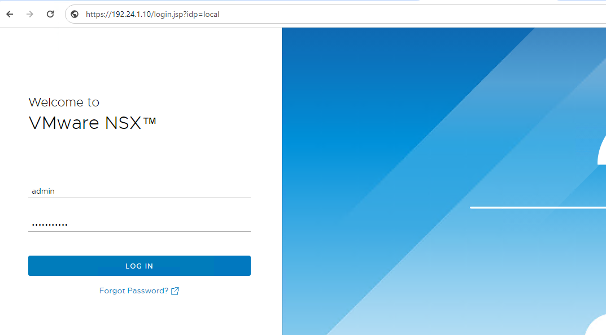

**Đạt khi:** đăng nhập được, NSX Manager `UP/Healthy` và thời gian đồng bộ chính xác.

## 4. Bước 1 – Kiểm tra và khai báo License

**Khái niệm:** license quyết định tính năng NSX được phép triển khai; trạng thái appliance chạy được **không có nghĩa** toàn bộ tính năng networking đều đã được cấp phép.

1. Trong NSX Manager, vào `System` → `Licenses` (menu tùy release).
2. Kiểm tra license hiện có, loại license và expiration/entitlement.
3. Chỉ thêm key mới khi được quản trị viên cung cấp và có quyền dùng.
4. Xác nhận trạng thái license hợp lệ, các tính năng networking cần thiết được hỗ trợ.

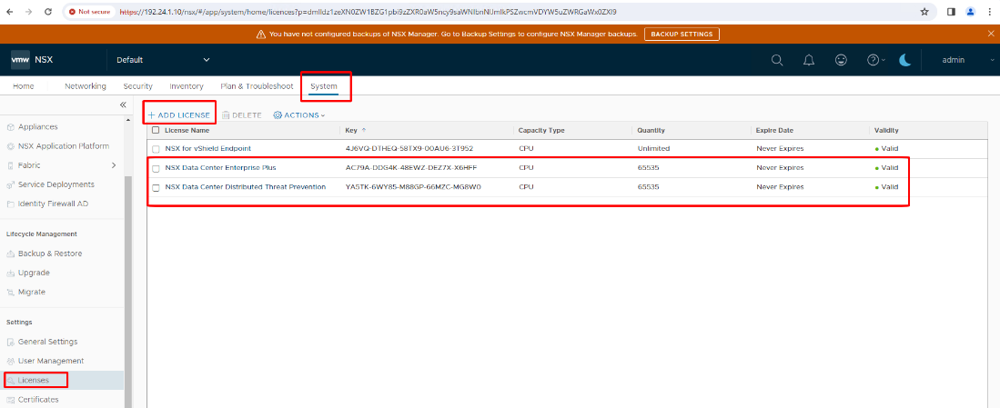

**Kiểm tra:** trạng thái license hợp lệ; không có cảnh báo bắt buộc chặn cấu hình. Nếu license theo subscription/VCF mới, menu và cách cấp quyền có thể khác ảnh.

## 5. Bước 2 – Tích hợp vCenter làm Compute Manager

**Tại sao:** NSX Manager cần kết nối vCenter để discover ESXi, cluster, vDS và deployment target cho Edge. `Compute Manager` **không thay vCenter** mà tích hợp với nó.

**Thao tác:**

1. `System` → `Fabric` → `Compute Managers` → `Add Compute Manager`.
2. Nhập tên dễ hiểu, ví dụ `vc-poc` (không sao chép tên vCenter của hệ thống cũ trong ảnh).
3. `Type`: `vCenter`; `FQDN or IP`: địa chỉ vCenter POC (ví dụ `192.24.1.11`, chỉ dùng nếu đúng thực tế).
4. Cổng thông thường `443`; nhập tài khoản được phân quyền thích hợp (ảnh gốc dùng `administrator@vsphere.local` chỉ để minh họa).
5. Kiểm tra **SHA-256 Thumbprint** của certificate vCenter với giá trị tin cậy từ quản trị viên trước khi chấp nhận.
6. Các tùy chọn `Create Service Account`, `Enable Trust`, `Access Level` phụ thuộc phiên bản và use case; không tự bật tất cả vì ảnh đang bật/tắt.
7. Nhấn `Add`; chờ kết nối/registration thành công.

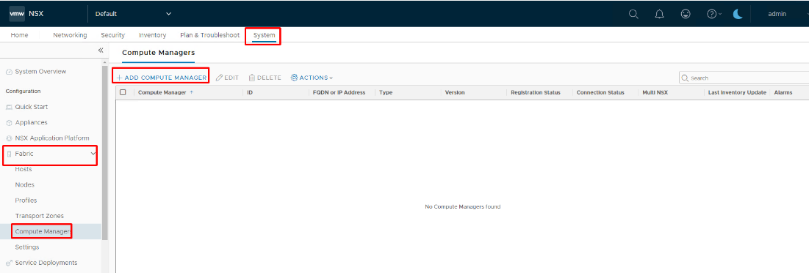

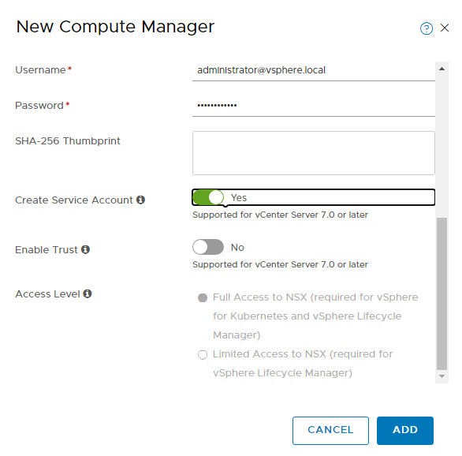

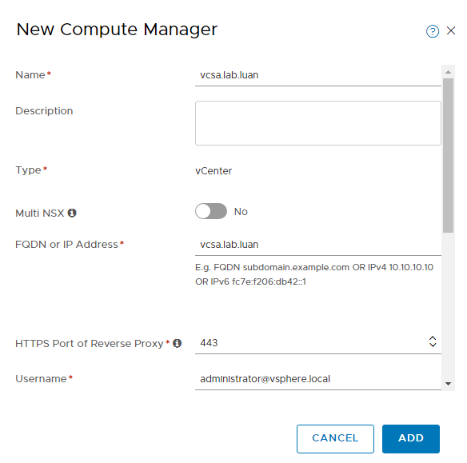

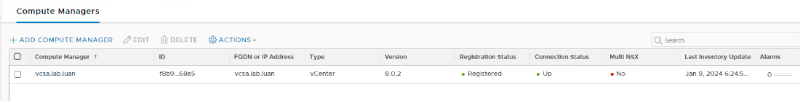


**Giải thích lựa chọn:**

- `Create Service Account`: phương án dùng tài khoản được NSX quản lý cho tích hợp khi phiên bản hỗ trợ.
- `Enable Trust`: thiết lập quan hệ tin cậy phục vụ tích hợp; **không phải checkbox bắt buộc trong mọi môi trường**.
- `Access Level`: quyền điều khiển NSX phù hợp chức năng; chọn theo hướng dẫn phiên bản/license và principle of least privilege.

**Đạt khi:** `Compute Manager Status/Connection = Registered/Up` theo UI hiện tại; nhìn thấy vCenter và cluster/host. Nếu `Not Registered`, kiểm tra DNS/FQDN, HTTPS 443, certificate, quyền và time sync trước.

## 6. Bước 3 – Tạo Transport Zones (Overlay và VLAN)

**Transport Zone (TZ) là gì?** Hãy hình dung TZ như một phạm vi nơi các Transport Node được phép sử dụng cùng loại logical segment. TZ **không phải VLAN ID** và không tự tạo ra mạng/subnet.

### 6.1. Overlay Transport Zone

1. Vào `System` → `Fabric` → `Transport Zones` → `Add`.
2. Name: `tz-overlay-poc`.
3. Transport type: `Overlay`.
4. Chọn mode/options phù hợp UI và lưu.

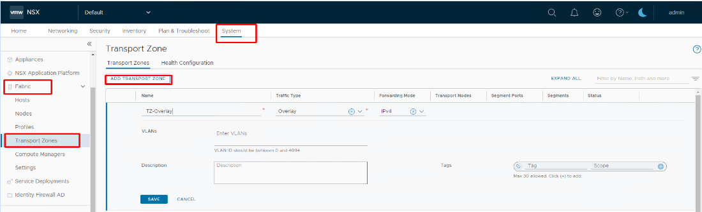

**Ý nghĩa:** khi ESXi và Edge cùng thuộc Overlay TZ này, các node có cơ sở để vận chuyển traffic của overlay segments qua Geneve/TEP.

### 6.2. VLAN Transport Zone

1. Cùng menu, chọn `Add`.
2. Name: `tz-vlan-poc`.
3. Transport type: `VLAN`.
4. Lưu và xác minh đúng loại VLAN-backed Transport Zone.

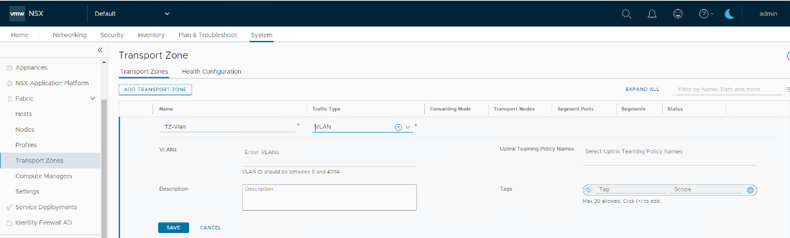

**Ý nghĩa:** tạo VLAN-backed Segment để đưa Tier-0 Edge uplink ra external VLAN. Đây là cách khác với Overlay Segment: VLAN segment sẽ gắn với VLAN ID trên underlay, không tự biến mạng external thành tunnel Geneve.

**Đạt khi:** có 2 TZ riêng, loại Overlay/VLAN chính xác. Không tạo `Transport VLAN` trong Uplink Profile chỉ để thay thế cho `VLAN TZ`.

## 7. Bước 4 – Tạo IP Pools cho TEP

**Khái niệm:** IP Pool cấp địa chỉ cho Tunnel Endpoints. IP này **không dùng làm IP VM tenant**, không phải NSX Manager IP, không phải gateway NAT.

### 7.1. Host TEP IP Pool

1. Vào `Networking` → `IP Address Pools` (một số phiên bản đặt menu khác).
2. `Add IP Address Pool` → Name: `pool-host-tep-poc`.
3. `Add Subnet` → `IP Ranges`: `192.24.2.100–192.24.2.149`.
4. `CIDR`: `192.24.2.0/24`; `Gateway`: `192.24.2.1` **chỉ nếu** đây là gateway được cấu hình trên underlay thật.
5. Lưu, kiểm tra không trùng DHCP/static allocation.

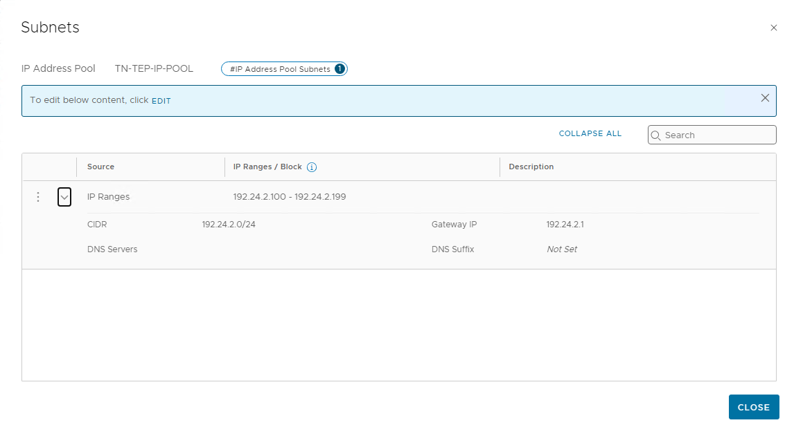

### 7.2. Edge TEP IP Pool

1. Tạo pool thứ hai `pool-edge-tep-poc`.
2. `IP Ranges`: `192.24.3.100–192.24.3.149`.
3. `CIDR`: `192.24.3.0/24`; `Gateway`: `192.24.3.1` **chỉ khi có** thiết bị underlay thực sự định tuyến mạng này.
4. Lưu. Kiểm tra được hai pool tách biệt.

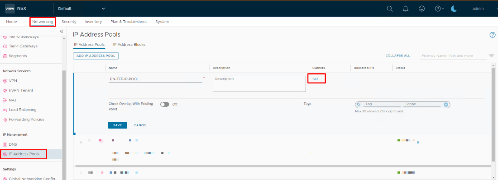
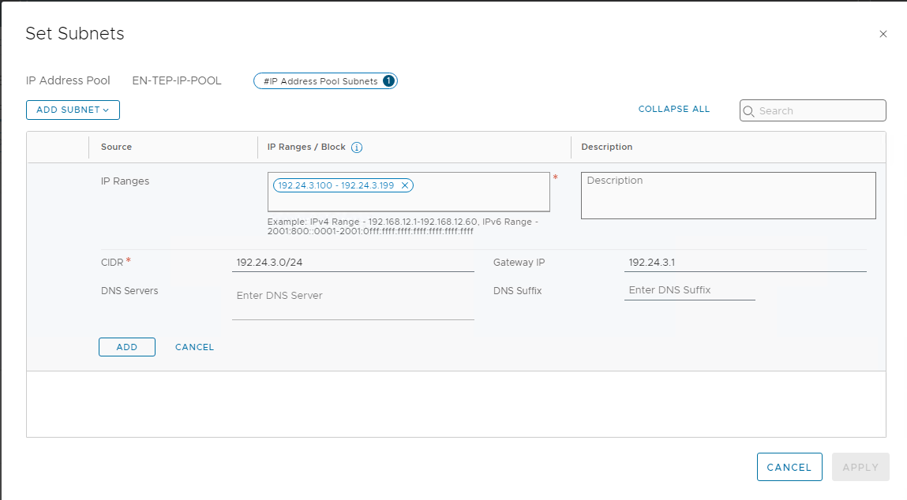

**Vì sao tách pool?** giúp kiểm soát và chẩn đoán từng nhóm Host vs Edge. Trong bản lab này chúng còn nằm ở **hai subnet khác nhau**, nên phải định tuyến 2 chiều. Không suy luận rằng cấu hình đúng chỉ vì nhập được IP pool.

**Kiểm tra trước bước tiếp:** từ thiết bị underlay xác nhận route tới cả hai subnet và MTU hợp lệ. Nếu không có L3 routing giữa chúng, **dừng và trao đổi người hướng dẫn**, không nhảy sang Prepare Host.

## 8. Bước 5 – Tạo Uplink Profiles

**Khái niệm:** Uplink Profile định nghĩa NSX sử dụng các uplink (logical uplink `Uplink 1`, `Uplink 2`) như thế nào, có VLAN tagging transport và MTU gì. `Uplink 1/2` là nhãn logic, cần map với **vDS dvUplink/physical NIC** hoặc Edge vNIC/portgroup ở bước sau.

**Cần phân biệt:**

- **Host Uplink Profile:** dành cho ESXi Transport Node.
- **Edge Overlay Uplink Profile:** dành cho Host Switch overlay của Edge.
- **Edge VLAN Uplink Profile:** dành cho Host Switch VLAN/external của Edge.
- Các profile có thể có thuộc tính khác nhau; **không dùng bừa profile host cho edge** vì cách map khác.

### 8.1. Host Uplink Profile

1. `System` → `Fabric` → `Profiles` → `Uplink Profiles` → `Add`.
2. Name: `up-host-overlay-poc`.
3. Chọn `Teaming Policy`: với một uplink lab có thể dùng `Failover Order`/`Load Balance Source` theo UI và mapping vDS thực tế; **đừng mặc định chọn 2 active uplinks nếu chỉ có 1 NIC**.
4. Khai báo tên uplink (`Uplink 1`...), xác định `Transport VLAN`: `<HOST_TEP_VLAN>` từ sơ đồ vDS. **Không dùng số VLAN từ ảnh cũ.**
5. Cấu hình MTU được underlay hỗ trợ end-to-end; Geneve yêu cầu tối thiểu khoảng **1600** tại transport path, thường lập kế hoạch 1700 hoặc lớn hơn nếu toàn mạng hỗ trợ. Không chỉ sửa một phía.
6. Save.

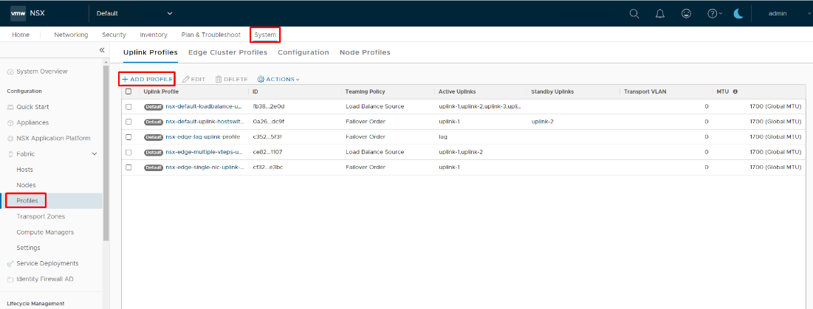

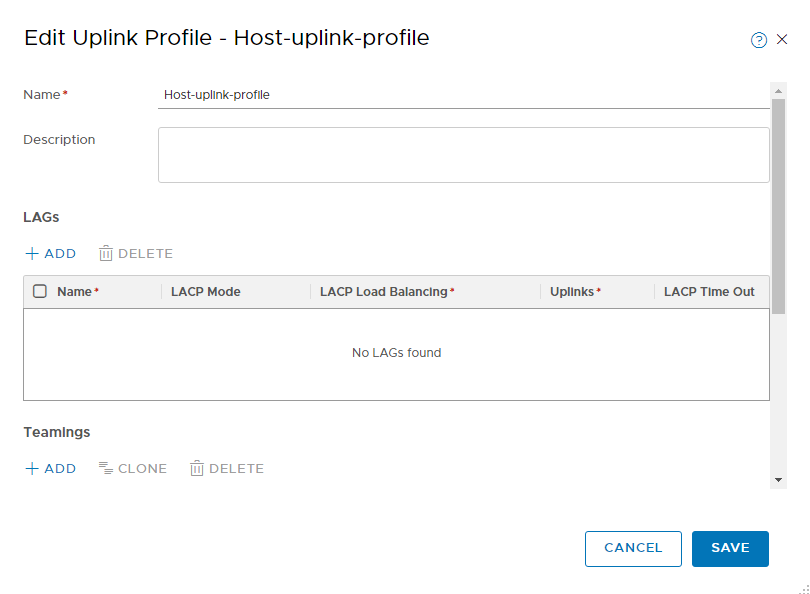

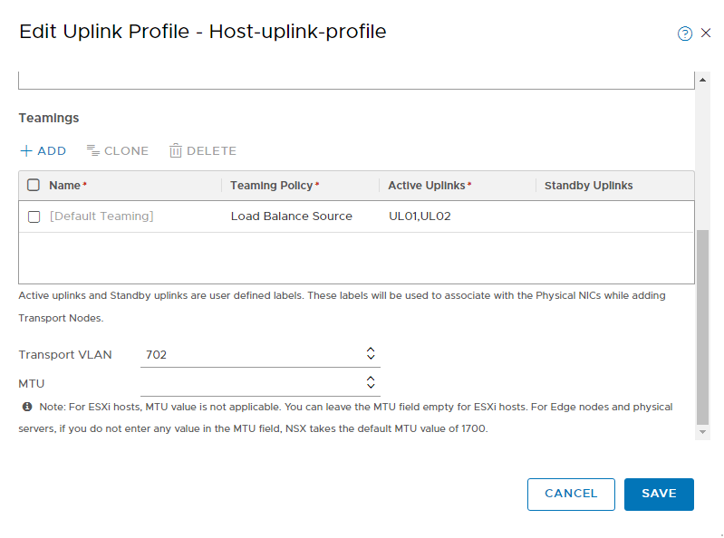

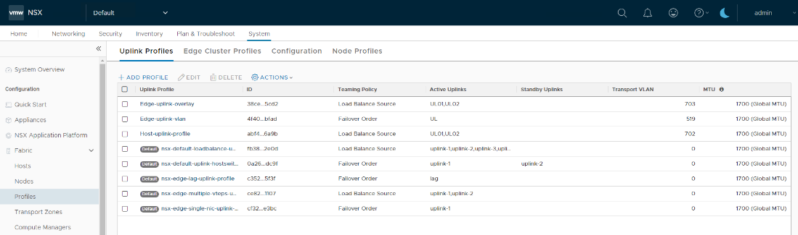

### 8.2. Edge Overlay / Edge VLAN Uplink Profiles

Tạo riêng `up-edge-overlay-poc` và `up-edge-vlan-poc` (nếu mô hình/version cần). Chọn các uplink tương ứng với Edge vNIC. Nếu Edge TEP dùng IP Pool để nhận IP, cấu hình phải map đúng Overlay switch và TEP network. **External uplink VLAN** là VLAN-backed segment phục vụ Tier-0; không tự suy ra từ `Transport VLAN` dùng cho TEP.

**Đạt khi:** hồ sơ đặt tên rõ, VLAN/MTU/teaming được xác nhận với vDS; sẵn sàng để dùng trong Host và Edge.

## 9. Bước 6 – Tạo Transport Node Profile cho ESXi

**Tại sao:** NSX sẽ gắn cấu hình lên ESXi host: chọn vDS, Transport Zone, Uplink Profile, cách cấp TEP IP, uplink mapping. Đây là bước thay đổi **datapath** của host, không chỉ tạo đối tượng quản lý.

**Thao tác:**

1. Vào `System` → `Fabric` → `Profiles` → `Transport Node Profiles` → `Add`.
2. Name: `tnp-esxi-poc`.
3. `Add Host Switch`: chọn vDS mà ESXi POC đang sử dụng. Chỉ chọn vDS sau khi kiểm tra vmnic và các portgroup management.
4. Transport Zone: `tz-overlay-poc`; chỉ thêm `tz-vlan-poc` lên host khi có use case VLAN segment trên host theo thiết kế.
5. Uplink Profile: `up-host-overlay-poc`.
6. TEP IP Assignment: `Use IP Pool` → `pool-host-tep-poc`.
7. Teaming Uplink Mapping: map `Uplink 1/2` tới đúng `dvUplink` hoặc interface đã dự kiến.
8. Kiểm tra kỹ rồi `Save`.

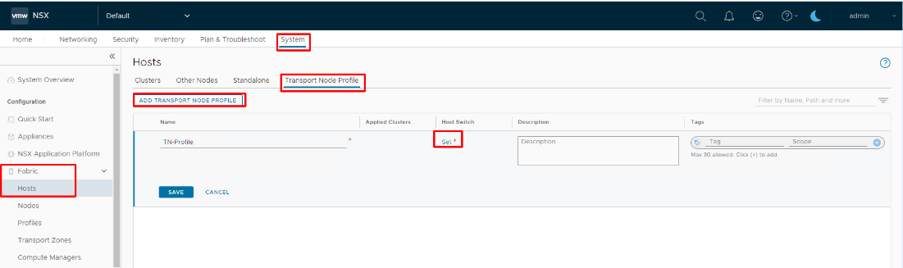
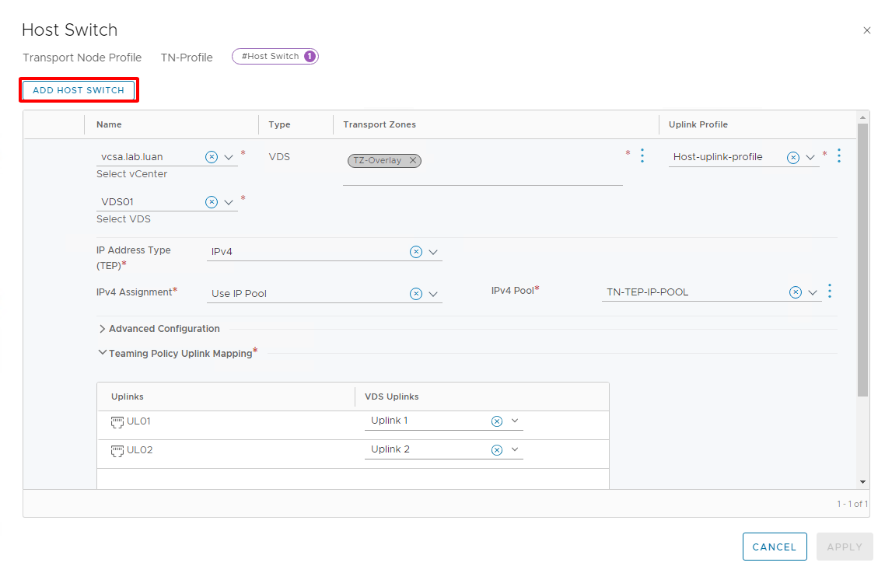

**Giải thích quan trọng:** Host **không cần** lấy IP Management `192.24.1.x` để tạo Geneve tunnel; nó lấy TEP từ `192.24.2.0/24`. `Transport Node Profile` là mẫu cấu hình, mới tạo xong **chưa có nghĩa ESXi đã được prepared**.

**Rủi ro:** map nhầm uplink có thể làm mất Management kết nối ESXi/vCenter. Bắt buộc rà sơ đồ trước, có cách vào host qua out-of-band để rollback.

## 10. Bước 7 – Prepare ESXi Host (Host Transport Node)

**Đây là bước quan trọng nhất với 1 host POC.** Khi Prepare, NSX cài đặt/cấu hình host networking trên ESXi theo profile đã tạo.

1. `System` → `Fabric` → `Hosts` (hoặc `Nodes` → `Host Transport Nodes`, tùy version).
2. Chọn cluster chứa ESXi POC. Với cluster chỉ có một host, vẫn áp profile lên cluster nếu UI/workflow yêu cầu.
3. Chọn `Configure NSX` / `Apply Transport Node Profile` → chọn `tnp-esxi-poc`.
4. Xác nhận tác động trước khi áp; quan sát `Installation/Configuration Status`.
5. Chờ trạng thái `Success/Up` theo UI. Không restart host/service chỉ vì trạng thái chuyển `In Progress` trong vài phút.
6. Xác nhận ESXi host còn kết nối vCenter, Management và TEP VMkernel đã được tạo đúng `192.24.2.x`.

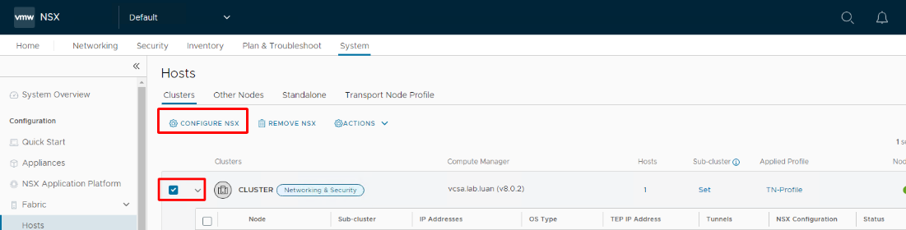
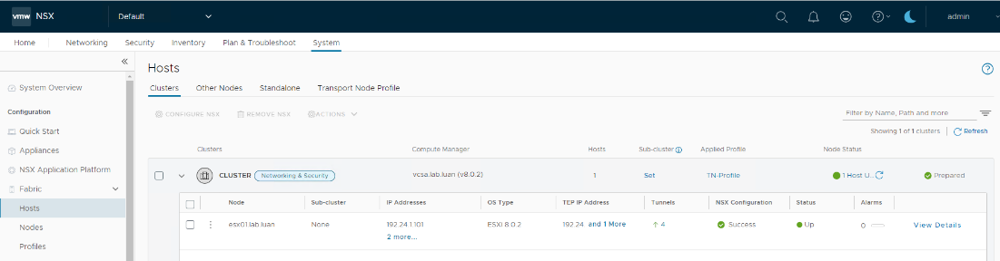

**Kiểm tra read-only tại ESXi Shell (nếu được phép):**

```bash
esxcli network ip interface list
esxcli network ip interface ipv4 get
esxcli network ip route ipv4 list
esxcli network vswitch dvs vmware list
```

- `interface list`: kiểm tra VMkernel interface đã xuất hiện.
- `ipv4 get`: xác định `vmk` TEP và IP pool được cấp.
- `route ipv4 list`: xem route trong network stack liên quan (mặc định không đủ để suy luận riêng tất cả TEP route).
- `dvs ... list`: xác minh vDS và uplink; không chỉnh sửa bằng CLI trong buổi onboarding.

**Đạt khi:** trạng thái Host Transport Node healthy, không có configuration failed, TEP đúng pool, host vẫn truy cập được vCenter. Nếu fail, xem Alarm/Details đầu tiên, soát VLAN/dvUplink/IP Pool/MTU, không gỡ NSX hoặc force delete host tùy tiện.

## 11. Bước 8 – Tạo NSX Edge Transport Node

### 11.1. Edge làm gì?

NSX Edge là VM được dùng để chạy dịch vụ mạng như Tier-0/Tier-1 service router, NAT, VPN và North–South routing theo thiết kế. NSX Manager điều khiển và cấu hình Edge, còn **Edge xử lý datapath**, không đồng nghĩa NSX Manager là router.

Trong tài liệu gốc có **edge01 và edge02**. Với **POC một physical ESXi host**, có thể triển khai **một Edge** để học cấu hình cơ bản; hai Edge VM trên cùng host chỉ giúp lab một số cơ chế logical failover, **không tạo HA chống lỗi physical host**. Kiểm tra phiên bản/HA mode và tài nguyên trước khi quyết định.

### 11.2. Khai báo Edge VM: Name, Size, Credentials, Placement

1. `System` → `Fabric` → `Nodes` → `Edge Transport Nodes` → `Add Edge Node` (tên menu theo ảnh gốc).
2. `Name`: `edge01-poc`; `Host name/FQDN`: do DNS POC phân giải được.
3. `Form Factor`: chọn theo sizing/product version. Ảnh gốc hiển thị một tùy chọn lớn; **không dùng kích thước đó như bắt buộc cho lab**.
4. `Credentials`: cài CLI admin/root passwords mạnh, tuân thủ chính sách; SSH chỉ bật khi thực sự cần quản trị và được cho phép.
5. `Configure Deployment`: chọn Compute Manager vCenter POC, cluster, resource pool, host và datastore thực sự có dung lượng.
6. Chọn network Management phù hợp, tránh đặt Edge trên portgroup tenant.

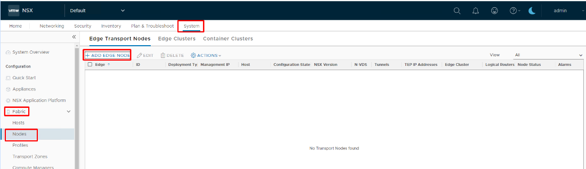
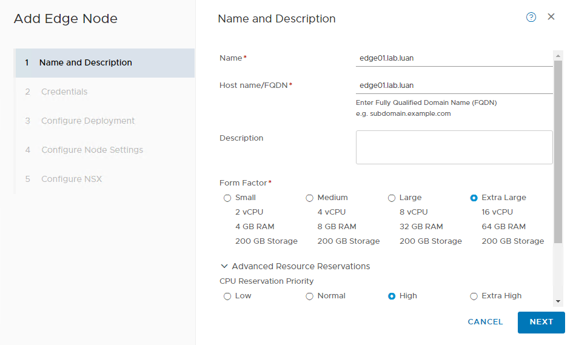
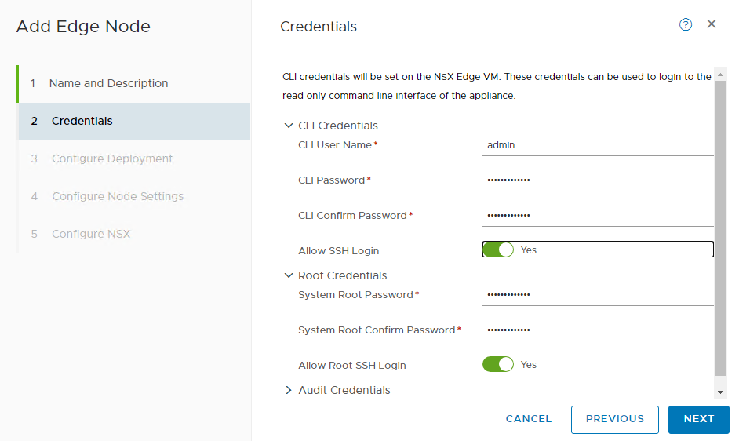
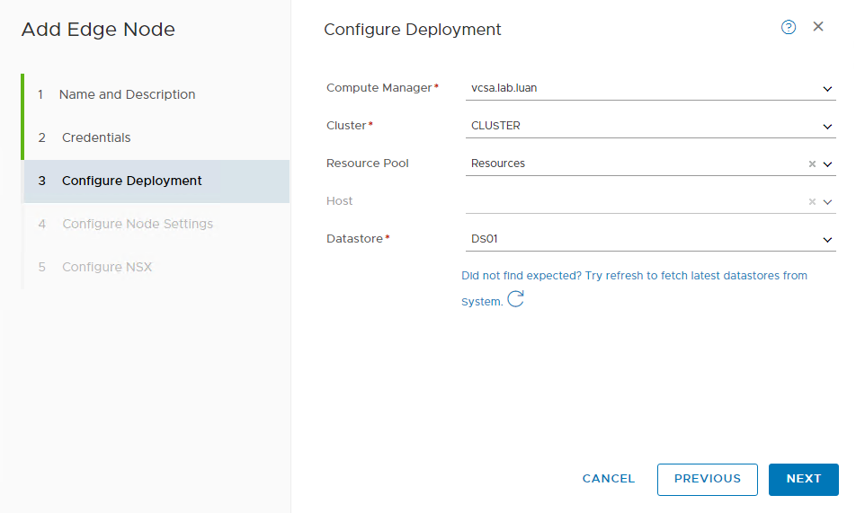

### 11.3. Cấu hình Edge Management Network

Trong `Configure Node Settings`:

- IP assignment: `Static` nếu theo plan.
- `Management IP`: `192.24.1.20/24` (ví dụ Edge01).
- `Default Gateway`: `192.24.1.1` (phải là gateway thực).
- `Management interface/network`: chọn Management portgroup chứa subnet `.1/24`.
- `DNS`: IP máy DC/DNS POC thực tế; **không suy diễn IP từ ảnh gốc**.
- `NTP`: trỏ về `dc.tpcloud.poc` nếu đã được cấu hình NTP hợp lệ.

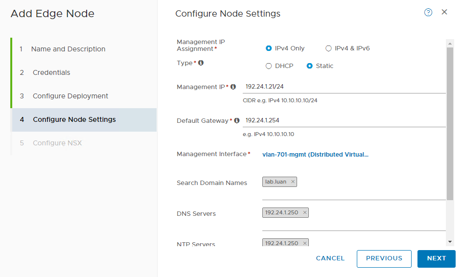

**Phân biệt rõ:** Management Edge `192.24.1.20` chỉ phục vụ quản trị. Edge TEP sẽ lấy IP **`192.24.3.x`** tại bước Overlay switch; Tier-0 uplink IP là một interface mạng **khác nữa**.

### 11.4. Cấu hình Node Switch A – VLAN/External

1. Trong màn hình `Configure NSX`, chọn `Add Switch`.
2. `Edge Switch Name`: ví dụ `edge-vlan-sw`.
3. `Transport Zone`: `tz-vlan-poc`.
4. `Uplink Profile`: `up-edge-vlan-poc`.
5. Map `Uplink 1` tới đúng Edge data vNIC/portgroup theo sơ đồ vDS.
6. Kiểm tra physical VLAN trunk và dvPortgroup/NSX-backed segment cho đúng external uplink.

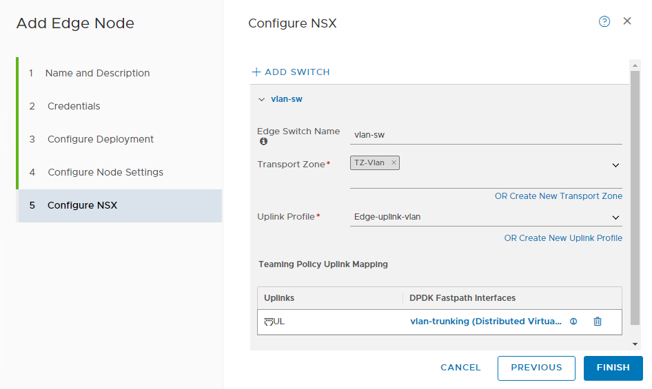

**Ý nghĩa:** host switch VLAN đưa Edge ra VLAN-backed segment nơi Tier-0 external interface sẽ hoạt động. **Chưa hề định nghĩa IP Tier-0 chỉ bằng việc tạo switch này**.

### 11.5. Cấu hình Node Switch B – Overlay/TEP

1. `Add Switch` lần nữa → `Edge Switch Name`: `edge-overlay-sw`.
2. `Transport Zone`: `tz-overlay-poc`.
3. `Uplink Profile`: `up-edge-overlay-poc`.
4. `TEP IP Assignment`: `Use IP Pool` → `pool-edge-tep-poc`.
5. Map overlay uplink sang đúng Edge data vNIC/portgroup mạng Edge TEP.
6. Đối chiếu `192.24.3.0/24` và route/MTU underlay tới Host TEP `192.24.2.0/24`.
7. Hoàn tất wizard, chờ Edge deploy và register.

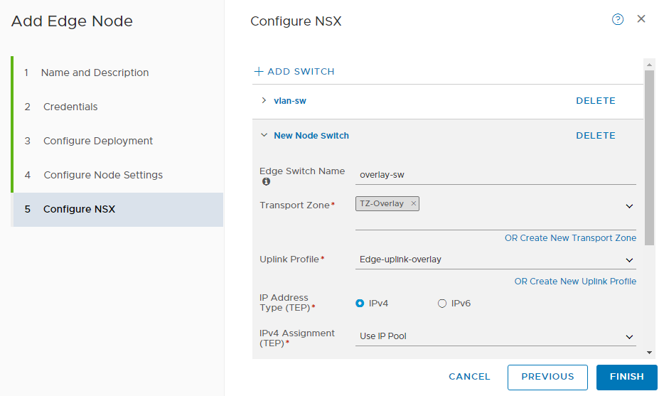
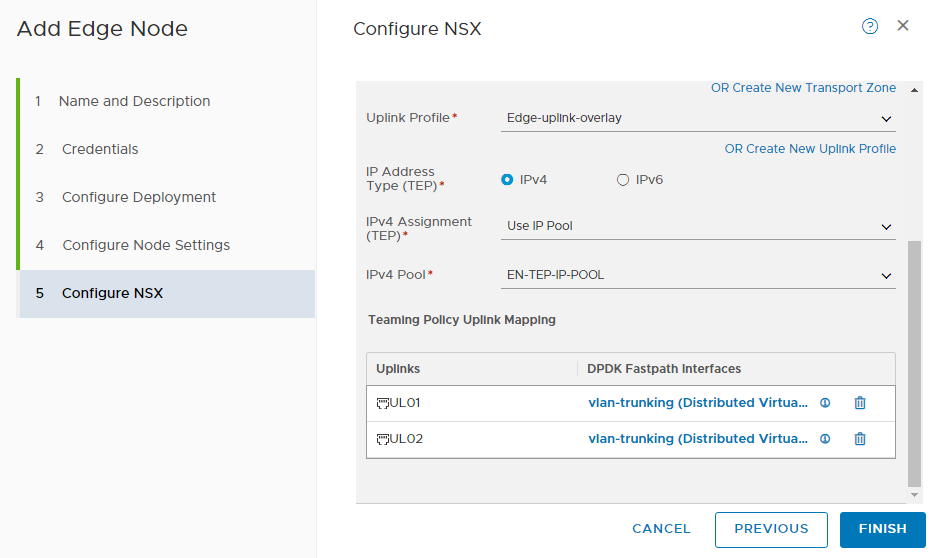

**Vì sao Edge có 2 switch?** Một switch phục vụ **VLAN/external**, switch còn lại phục vụ **Geneve overlay**. Hai loại traffic không đồng nghĩa nhau. `Overlay TZ` và `VLAN TZ` là đối tượng logical; các `uplink profile` chứa chính sách kết nối của node, không phải tên VLAN.

### 11.6. Kiểm tra kết quả Edge và tùy chọn Edge02

1. Trong `Edge Transport Nodes`, theo dõi deployment/configuration status đến khi `Success/Up`.
2. Kiểm tra IP Management, Edge TEP, appliance health, và BFD/Geneve tunnel Host ↔ Edge.
3. Nếu bài thực hành có Edge02, lặp quy trình với Management IP mẫu `192.24.1.21` và TEP IP riêng trong `pool-edge-tep-poc`.
4. Không coi hai Edge VM trên một ESXi host là HA production.

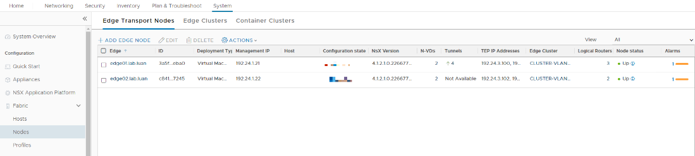
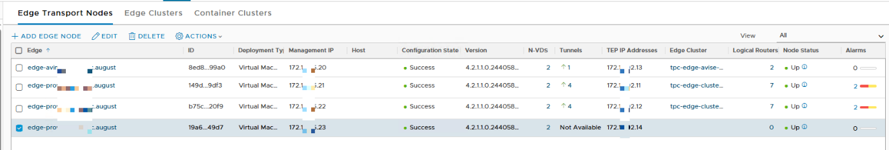

**Đạt khi:** Edge Node reachable, Transport Node status healthy, overlay tunnel host-edge up. Nếu Management hoạt động mà tunnel down, kiểm tra **underlay TEP**, không kết luận Edge deploy đã thành công hoàn toàn.

## 12. Bước 9 – Tạo Edge Cluster

**Khái niệm:** Edge Cluster gom các Edge Transport Nodes để NSX chạy Tier-0/Tier-1 service. Cụm này cho phép phân bố/failover dịch vụ phù hợp HA mode và số Edge Node, nhưng **không bảo vệ khỏi sự cố ESXi duy nhất**.

1. `System` → `Fabric` → `Nodes` → tab `Edge Clusters` → `Add Edge Cluster`.
2. Name: `edge-cluster-poc`.
3. Chọn `Edge Cluster Profile` mặc định nếu phù hợp use case/phiên bản; không copy tên profile/cluster từ hệ thống cũ.
4. `Transport Nodes`: đưa `edge01-poc` sang danh sách thành viên. Nếu có Edge02, thêm Edge02.
5. Save và kiểm tra trạng thái cluster.

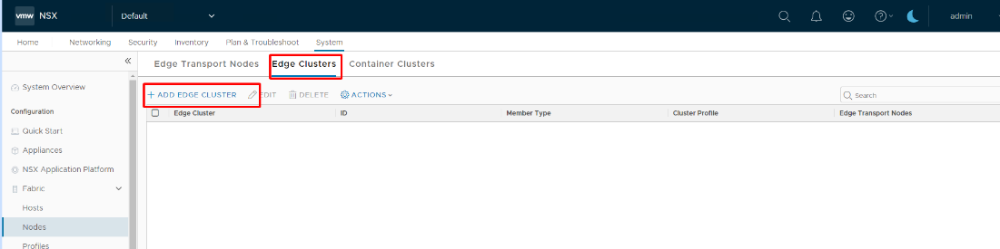

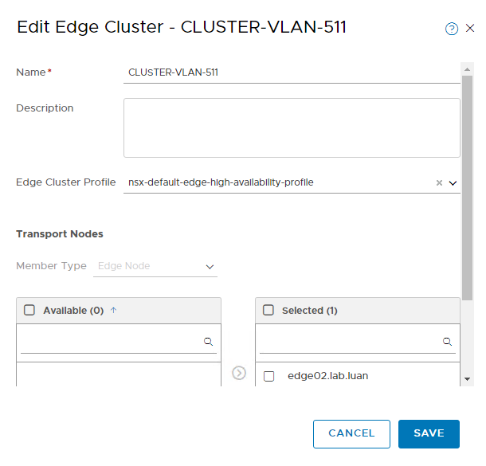

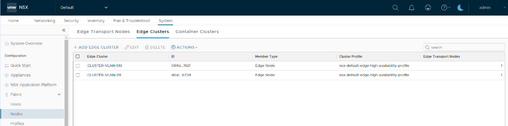

**Đạt khi:** thành viên Edge hiển thị healthy và có thể chọn Edge Cluster khi tạo Tier-0. **Một Edge duy nhất = SPOF của Edge datapath**; hai Edge trên cùng ESXi vẫn = SPOF physical host.

## 13. Bước 10 – Tạo VLAN-backed Segment cho Tier-0 Uplink

**Nguồn gốc:** file Word có phần `Cấu hình segment uplink` ngay trước khi tạo Tier-0. IP/VLAN trong ảnh thuộc hệ thống cũ; chỉ minh họa vị trí nút bấm.

1. Xác nhận từ Network team: `<EXTERNAL_VLAN>`, upstream L2/L3, `<T0_UPLINK_IP/CIDR>`, `<UPSTREAM_NEXT_HOP>`, cách khai báo NAT/public IP.
2. `Networking` → `Segments` → `Add Segment`.
3. `Name`: `seg-t0-uplink-poc`.
4. `Transport Zone`: `tz-vlan-poc`.
5. `VLAN`: `<EXTERNAL_VLAN>` đã được cấp (chưa biết thì **không nhập đại**).
6. `Connected Gateway`: **None/Not Connected** cho VLAN external segment dùng để gắn T0 interface (tùy UI và use case).
7. Save, kiểm tra `Segment` created/realtime status successful.

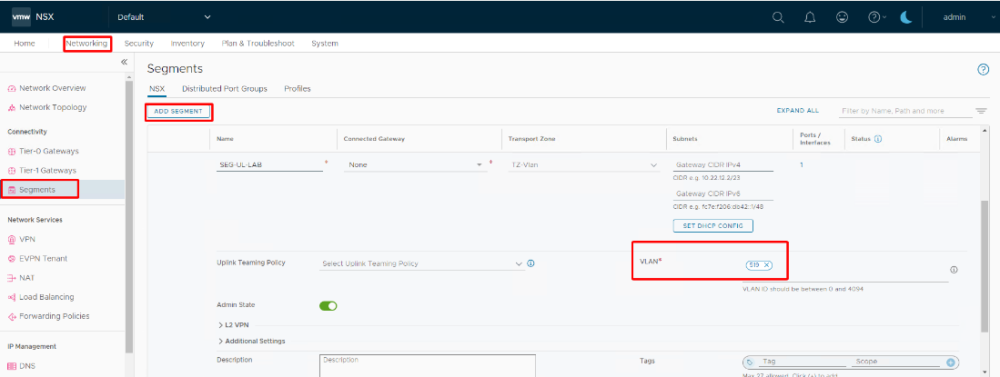
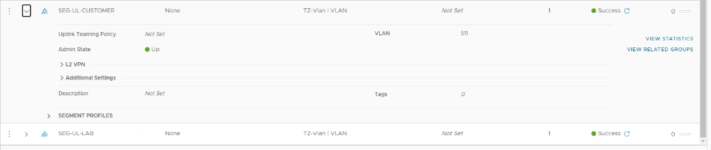

**Ý nghĩa:** segment là domain L2 để Edge uplink/Tier-0 external interface tiếp xúc mạng external. Nó **không tự tạo route**, không tự cấp IP Tier-0 và không cần đi vòng qua Sophos nếu thiết kế T0 kết nối trực tiếp upstream.

## 14. Bước 11 – Tạo Tier-0 Gateway

### 14.1. Tier-0 là gì?

T0 là logical router kết nối NSX fabric với external router/firewall/upstream. T0 **không phải** Edge Node: nó là đối tượng logic/service được NSX đặt chạy trên Edge Cluster. Một T0 có thể cung cấp North–South connectivity cho các T1/segments tùy topology.

1. `Networking` → `Tier-0 Gateways` → `Add Tier-0 Gateway`.
2. Name: `t0-poc`.
3. Chọn `Edge Cluster`: `edge-cluster-poc`.
4. Chọn `HA mode`: phù hợp số Edge Node và routing design. Với Edge01 duy nhất không tuyên bố HA.
5. Các lựa chọn BGP/ECMP/Service Interface/VRF chỉ cấu hình nếu thuộc scope lab.
6. Save; kiểm tra trạng thái T0.

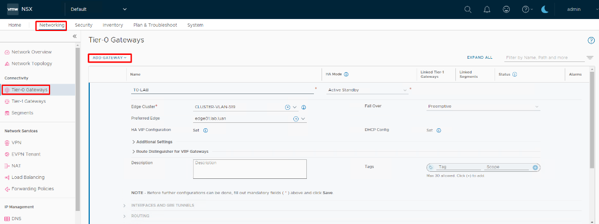

### 14.2. Tạo Tier-0 External Interface

1. Edit `t0-poc` → `Interfaces` / `Set Interfaces` → `Add Interface`.
2. `Name`: `uplink-t0-poc`.
3. `Type`: `External`.
4. `IP Address/Mask`: `<T0_UPLINK_IP/CIDR>` do người phụ trách network cấp.
5. `Connected Segment`: `seg-t0-uplink-poc`.
6. `Edge Node`: `edge01-poc` (hoặc theo thiết kế HA đã được phê duyệt).
7. `MTU`, `URPF mode` và các lựa chọn interface khác: dùng giá trị đã được thiết kế, không sao chép từ ảnh cũ.
8. Save, kiểm tra Interface status `Up` và ARP/neighbor reachability.

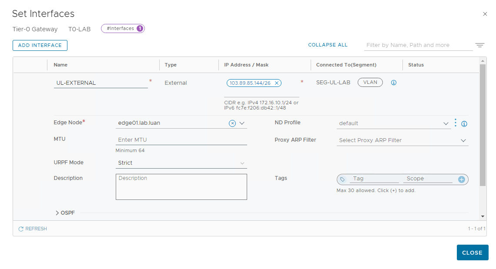

**Ranh giới địa chỉ:**

- `192.24.1.x` = Edge Management.
- `192.24.3.x` = Edge Overlay TEP.
- `<T0_UPLINK_IP/CIDR>` = IP Layer 3 trên **external segment**, **không lấy địa chỉ TEP `.2`/`.3` để gán**.

Nếu chưa được cấp mạng external, **dừng tại bước tạo T0**, đánh dấu bước interface là *pending input*. Đây là thiếu thông tin nguồn, không phải lỗi NSX.

## 15. Bước 12 – Thiết lập Routing cho Tier-0

### 15.1. Chọn Static Routing hay Dynamic Routing

Ảnh trong file gốc có các bước `Disable BGP routing và OSPF routing` rồi `Cấu hình static route`. Đây là lựa chọn thuộc **một use case static-route lab**, không phải quy tắc tắt BGP/OSPF cho mọi triển khai NSX. Production Cloud Provider thường cần đánh giá dynamic routing với network team.

1. Trước khi thay đổi, xác nhận Upstream có hỗ trợ/đang dùng BGP/OSPF hay chỉ static route.
2. **Chỉ với thiết kế static-only được duyệt**, giữ `BGP` và `OSPF` disabled theo tài liệu gốc.
3. Nếu có dynamic routing, **không áp dụng** đoạn này một cách máy móc; phải có riêng kế hoạch peering, ASN, neighbor, policy advertisement.

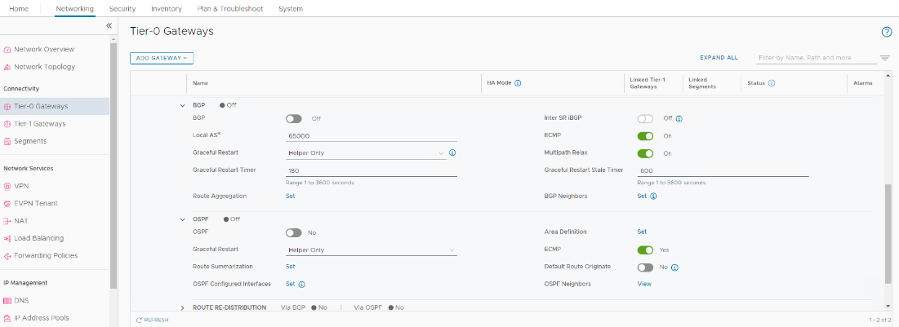

### 15.2. Tạo Default Static Route (nếu upstream là đường ra mặc định)

1. `Networking` → `Tier-0 Gateways` → Edit `t0-poc`.
2. `Routing` → `Static Routes` → `Set` → `Add Static Route`.
3. Name: `default-to-upstream`.
4. `Network`: `0.0.0.0/0` **nếu** đây là default route được thiết kế cho T0.
5. `Next Hops`: `<UPSTREAM_NEXT_HOP>` — phải là IP next-hop **reachable** qua T0 external uplink.
6. `Admin Distance`, `Scope`: dùng giá trị phù hợp, không chọn scope tùy tiện hoặc dùng `NULL` next-hop không có chủ đích.
7. Save/Apply, kiểm tra static route hiển thị đúng.

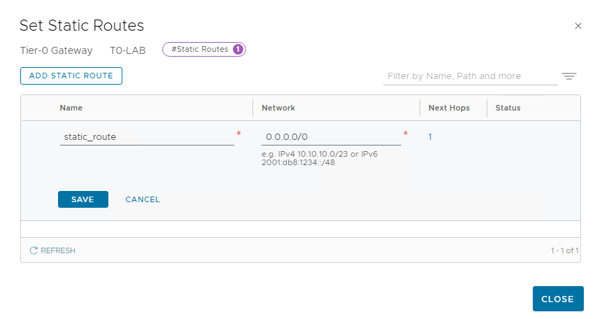

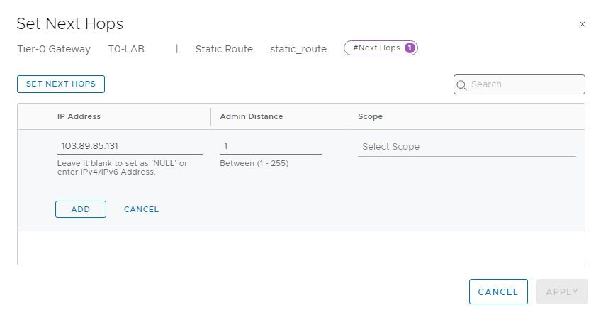

**Ý nghĩa:** route `0.0.0.0/0` chỉ bảo T0 gửi lưu lượng tới điểm nào khi không tìm được route cụ thể hơn. Nó **không tạo route chiều về** và **không tự NAT**. Muốn tenant VM ra ngoài còn cần kết nối T1/Segment, return routing và NAT/advertisement nếu topology yêu cầu.

### 15.3. Route Redistribution — khi nào cần?

Tài liệu gốc có thao tác `Set Route Re-distribution` với nhiều checkbox. Không nên bê nguyên trạng sang môi trường POC nếu chỉ dùng static routing.

- `Route Redistribution` lựa chọn route sources (connected, static, NAT IP, T1 routes...) để một cơ chế quảng bá có thể sử dụng.
- Khi **không chạy BGP/OSPF** để quảng bá ra peer, cấu hình redistribution **không thay thế** việc tạo static route hoặc route chiều về trên upstream.
- Các checkbox `Connected Interfaces & Segments`, `Static Routes`, `NAT IP` chỉ bật theo bài toán route advertisement. Không chọn tất cả cho chắc.

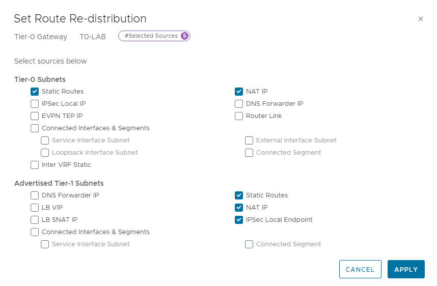
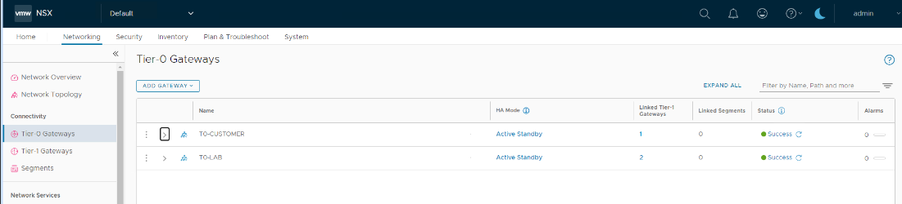

**Đạt khi:** T0 có external interface up, route mặc định xuất hiện nếu đã được cấu hình, và upstream có routing chiều về hoặc NAT tương ứng. Nếu lab đang pending external details, chưa thể xác nhận end-to-end Internet; chỉ nghiệm thu các bước nội bộ.

## 16. Bước 13 – Xác minh và Troubleshooting an toàn

### 16.1. Trình tự kiểm tra (từ dưới lên)

1. `vCenter`: NSX Manager VM/Edge VM powered on; ESXi host connected; Management không bị mất.
2. `Compute Manager`: NSX ↔ vCenter status Up.
3. `Host Transport Node`: host NSX prepared, TEP `192.24.2.x`, health green.
4. `Edge Transport Node`: Management `192.24.1.x`, TEP `192.24.3.x`, health green.
5. `Underlay`: host TEP ↔ edge TEP có route hai chiều, MTU đủ, không có tunnel BFD down.
6. `Edge Cluster`: nhận diện member đúng.
7. `VLAN-backed Segment`: đúng TZ và external VLAN; portgroup/uplink được trunk/tag đúng.
8. `Tier-0 External Interface`: subnet/gateway đúng, interface up.
9. `Static Route`: next-hop reachable; upstream có reverse route/NAT theo thiết kế.
10. Nếu có T1/Tenant VM ở lab mở rộng, kiểm tra T1, Segment, Gateway FW, NAT, routing chiều về trước khi kết luận “NSX không có Internet”.

### 16.2. Command read-only tham khảo

**Trên ESXi Shell (xác định đúng `vmk#` TEP trước):**

```bash
esxcli network ip interface list
esxcli network ip interface ipv4 get
esxcli network ip route ipv4 list
# Replace vmkX and destination with values confirmed in the lab:
vmkping -S vxlan -I vmkX <EDGE_TEP_IP>
# Optional MTU test only after confirming the underlay MTU path:
vmkping -S vxlan -I vmkX -d -s 1572 <EDGE_TEP_IP>
```

- `-S vxlan`: dùng networking stack Tunnel Endpoint phù hợp môi trường VMware NSX; xác nhận câu lệnh hỗ trợ với phiên bản ESXi.
- `-I vmkX`: chỉ định đúng TEP VMkernel, không thay bằng VMkernel management.
- `-d -s 1572`: kiểm tra đường truyền payload lớn với DF; nếu MTU/overhead không đủ có thể fail ngay cả khi ping nhỏ thành công. Không diễn giải một test đơn lẻ là bằng chứng tuyệt đối.

**Trên NSX Edge CLI (đăng nhập tài khoản admin, tùy phiên bản):**

```text
get interfaces
get logical-routers
get bfd-sessions
get bfd-sessions stats
```

Đây là các lệnh kiểm tra, không thay đổi cấu hình. Khi xác định được Tier-0 SR VRF, có thể dùng các lệnh VRF/route phù hợp phiên bản và tài khoản; không chép CLI từ hệ thống cũ nếu NSX release khác.

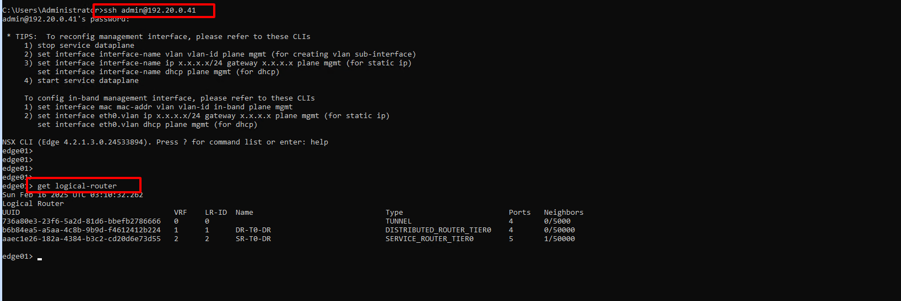
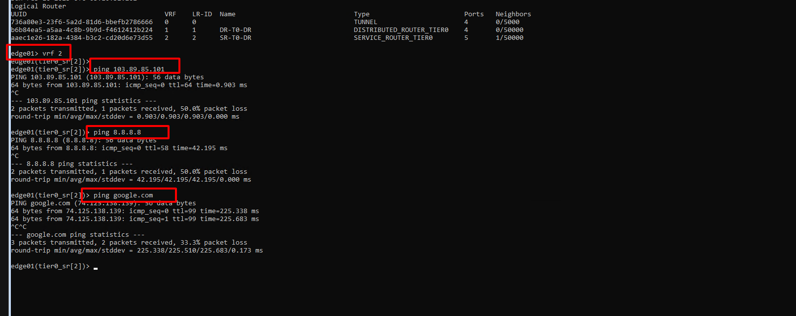

### 16.3. Bảng lỗi thường gặp

| Hiện tượng | Nguyên nhân nên kiểm tra đầu tiên | Hành động an toàn |
|---|---|---|
| Compute Manager `Not Registered` | DNS/FQDN, certificate thumbprint, credential, HTTPS 443, NTP | Xem alarm và connectivity, kiểm tra cert với admin; không disable certificate validation tùy tiện. |
| Host Prepare `Failed` | vDS selection, uplink mapping, VLAN/TEP pool, incompatibility | Xem task, details, ESXi connectivity và vCenter events trước khi sửa. |
| Edge VM UP nhưng Transport Node DOWN | Edge Overlay switch mapping, TEP VLAN/subnet, BFD/Geneve | Kiểm tra edge TEP và host TEP từ underlay, MTU, route. |
| TEP ping nhỏ OK nhưng VM traffic lỗi | MTU mismatch, Geneve payload | Test MTU với DF, kiểm tra MTU cả vDS/physical router/underlay path. |
| T0 interface DOWN | Segment/TZ sai, Edge vNIC mapping, VLAN không trunk | Check segmentation, VLAN tagging, interface attachment, ARP. |
| T0 ping được upstream nhưng tenant không đi được | Route chiều về, NAT, T1/Segment, gateway FW, tenant policy | Trace traffic theo từng hop; không tắt firewall hàng loạt. |
| Hai Edge cùng host bị lỗi host | Không có HA physical | Ghi rõ giới hạn POC; muốn HA host cần nhiều ESXi + thiết kế placement phù hợp. |

**Không làm khi chưa có change approval/rollback:** reconfigure vDS vmnic đang cấp Management, thay Transport VLAN, nâng MTU router đang chạy production, remove host khỏi NSX, force delete Transport Node, reboot/redeploy Edge đang gánh traffic, disable global firewall/DFW hoặc thay default route. 

## 17. Checklist nghiệm thu dành cho người hướng dẫn

| # | Hạng mục | Bằng chứng yêu cầu | Đánh giá |
|---|---|---|---|
| 1 | NSX Manager health/licensing | Screenshot System/License/alarms | ☐ Pass ☐ Fail |
| 2 | Compute Manager vCenter | `Registered/Up`; vCenter và host thấy được | ☐ Pass ☐ Fail |
| 3 | Transport Zone | Overlay/VLAN TZ đúng loại | ☐ Pass ☐ Fail |
| 4 | Host TEP Pool | `192.24.2.0/24`, không trùng cấp phát | ☐ Pass ☐ Fail |
| 5 | Edge TEP Pool | `192.24.3.0/24`, không trùng cấp phát | ☐ Pass ☐ Fail |
| 6 | Uplink Profiles | Mapping, MTU, VLAN có sơ đồ phê duyệt | ☐ Pass ☐ Fail |
| 7 | Host Transport Node | NSX prepared, status healthy, Host TEP assigned | ☐ Pass ☐ Fail |
| 8 | Edge Transport Node | Management & TEP tách biệt, health green | ☐ Pass ☐ Fail |
| 9 | Host↔Edge Geneve/BFD | Tunnels Up, MTU verified | ☐ Pass ☐ Fail |
| 10 | Edge Cluster | Node member & health correct | ☐ Pass ☐ Fail |
| 11 | External uplink VLAN | VLAN/underlay confirmed by Network team | ☐ Pass ☐ Fail ☐ Pending |
| 12 | Tier-0 Interface/Route | Interface Up, next-hop/reverse route verified | ☐ Pass ☐ Fail ☐ Pending |
| 13 | End-to-end tenant (mở rộng) | Test VM/route/NAT/policy theo lab mở rộng | ☐ Pass ☐ Fail ☐ N/A |

### 17.1. Câu hỏi tự kiểm tra cho kỹ sư mới

1. Vì sao NSX Manager và Edge không phải là một thành phần?
2. Host TEP `192.24.2.x` và Edge TEP `192.24.3.x` dùng để làm gì? Tại sao cần định tuyến giữa hai mạng này?
3. Overlay TZ khác VLAN TZ ở điểm nào?
4. Uplink Profile khác Transport Node Profile như thế nào?
5. Vì sao Tier-0 uplink IP không thể lấy bừa từ dải Edge TEP?
6. Thêm hai Edge VM trên một ESXi host có đạt HA production không?
7. Nếu Tier-0 có default route nhưng không truy cập được từ Tenant VM, cần kiểm tra thêm những gì?
8. Tại sao `192.24.1.0/24` không được xem là private address space theo RFC1918?
9. Khi Host Prepare mất mạng Management, thao tác an toàn đầu tiên là gì?
10. Ở cấu hình static-only, Route Redistribution có thay thế route chiều về của upstream không?

## 18. Những gì tài liệu gốc có / chưa có

**Có trong nguồn `NSX-T.docx`:** login, add license, add compute manager, Overlay/VLAN TZ, IP Pools Host/Edge, uplink profile, transport node profile, prepare host, add Edge node, Edge network management, Edge VLAN/Overlay switches, thêm Edge02, Edge Cluster, T0 uplink VLAN Segment, T0 gateway/interface, disable BGP/OSPF ở hệ thống cũ, static route, route redistribution và test Edge CLI.

**Được bổ sung để đào tạo (không xuất phát từ cấu hình xác nhận trong nguồn):** diễn giải công nghệ, sơ đồ quan hệ, kế hoạch IP ví dụ, nguyên tắc RFC1918, design precheck, MTU/underlay connectivity, sự khác nhau giữa Host/Edge/T0 IP, giới hạn POC 1 host, checklist/command read-only và quy trình troubleshoot.

**Chưa được xác nhận:** NSX release/build, vDS topology và number of dvUplinks, VLAN ID thực tế, IP và quyền sử dụng subnet, gateway DNS/NTP POC cụ thể, ngoại vi public/uplink subnet, next-hop upstream, license/size Edge và HA mode. Phải điền các tham số này trước khi coi là runbook có thể thực thi trọn vẹn.

### 18.1. Tài liệu đối chiếu kỹ thuật chính thức

- Broadcom KB [317168 — NSX Edge TEP networking options](https://knowledge.broadcom.com/external/article/317168/nsx-edge-tep-networking-options.html): lưu ý đặc biệt nếu Host TEP và Edge TEP cùng VLAN trên collapsed cluster.
- Broadcom KB [388345 — NSX Edge tunnels down in a collapsed cluster](https://knowledge.broadcom.com/external/article/388345/nsx-edge-tunnels-down-in-a-collapsed-clu.html): thiết kế Host TEP/Edge TEP và Edge uplink portgroup.
- Broadcom KB [330488 — MTU Mismatch Within Transport Zone](https://knowledge.broadcom.com/external/article/330488): kiểm tra MTU và Geneve path.
- Broadcom KB [379112 — TEP BFD troubleshooting](https://knowledge.broadcom.com/external/article/379112/troubleshooting-nsx-tepbfd-tunnels-betwe.html): CLI read-only kiểm tra tunnel.

> **Lưu ý về hình ảnh:** 43 hình là ảnh **tham khảo UI** trích từ tài liệu nguồn của nhiều hệ thống cũ. **Không sử dụng IP, VLAN, FQDN, kích thước Edge, tên cluster hoặc checkbox trong ảnh làm cấu hình cho POC.** Chỉ theo các giá trị đã được duyệt trong phần mô tả và bảng IP của guide mới. Hình ảnh không được chỉnh sửa để tránh làm sai lệch chứng cứ cấu hình gốc.

---

**Kết quả mong đợi:** người học hiểu cấu trúc, triển khai được NSX fabric/host/edge theo checklist, và biết điều kiện cần bổ sung trước khi đưa Tier-0 ra external network. Tài liệu này là **training guide cho POC**, không phải production deployment runbook hay phê duyệt kiến trúc.
